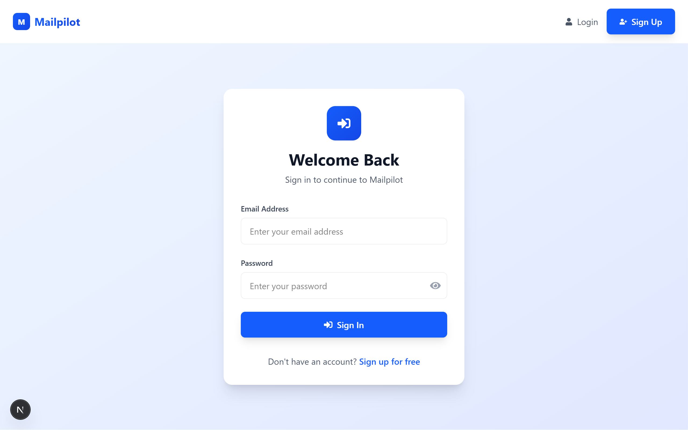
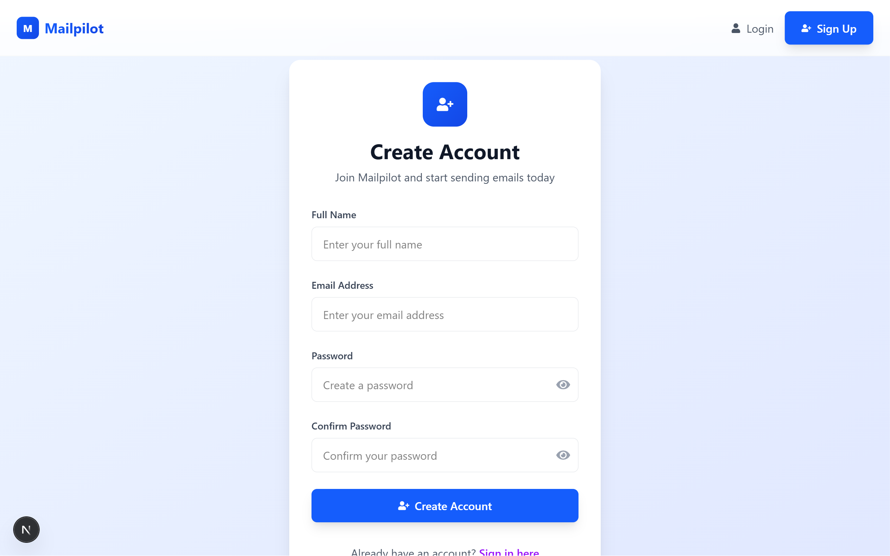
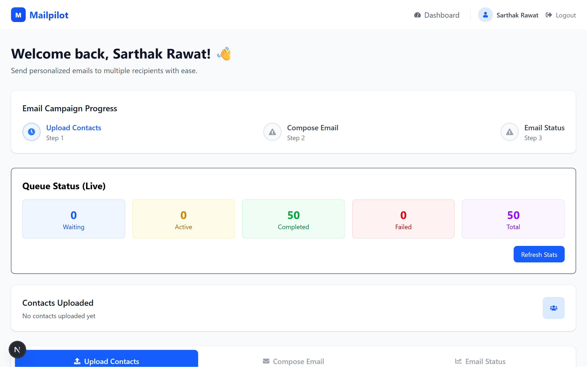
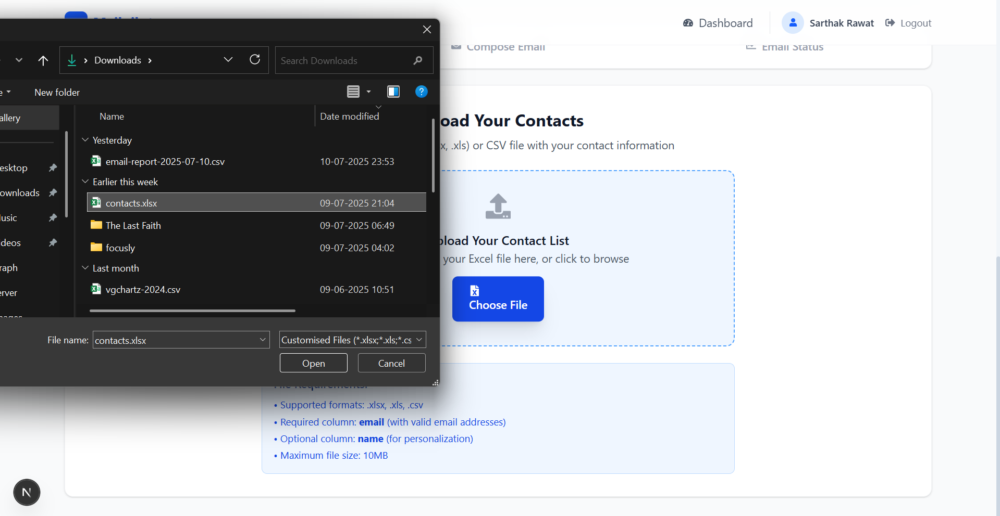
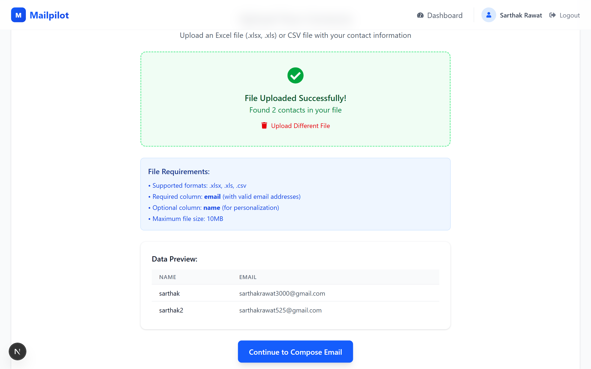
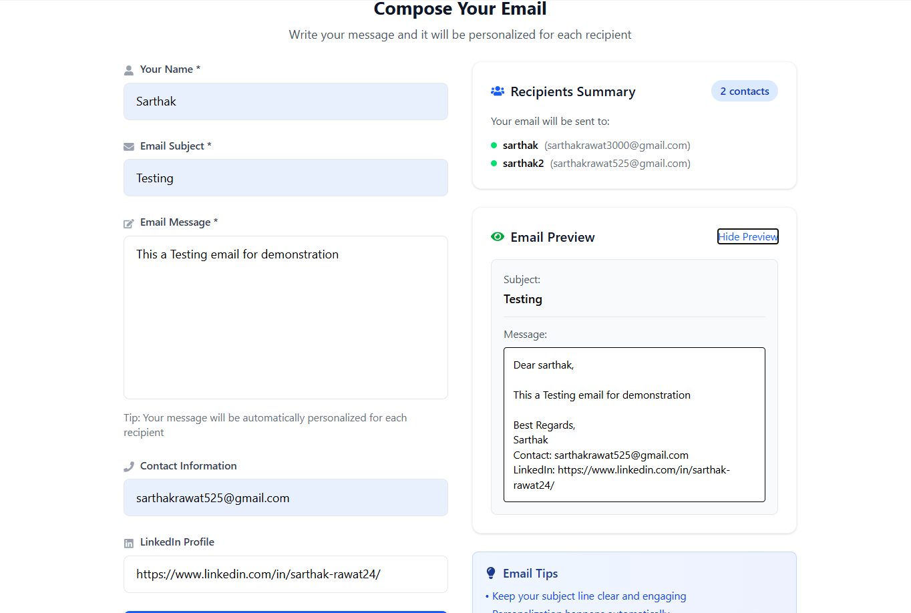
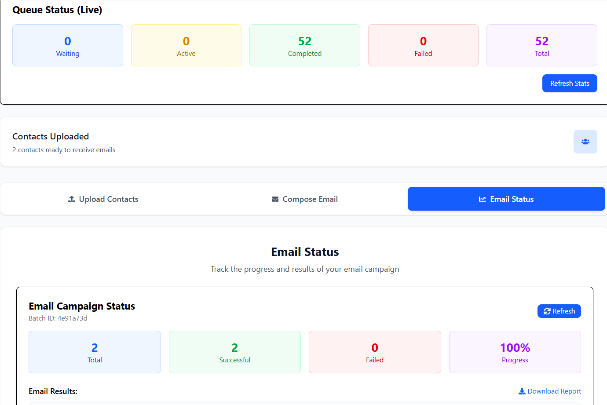
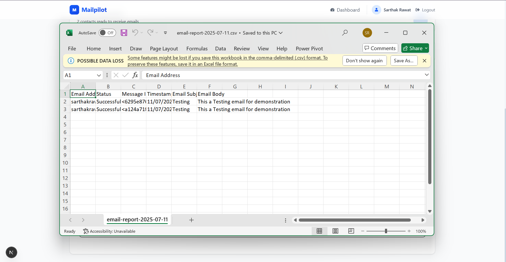

# Mailpilot: Bulk Email Automation 🚀

**Send smarter, personalized emails in bulk with ease. Leverage the power of Node.js, Next.js, and background processing for efficient and reliable email campaigns.**

<!-- Add other badges like build status, version, etc. if available -->

Mailpilot is a full-stack web application designed to streamline your mass email communication. Upload your contact lists, compose personalized messages, and let Mailpilot handle the efficient delivery and tracking of your emails.

✨ **[Watch the Demo Video](https://placeholder)** ✨

## Key Features 🎯

- 📧 **Bulk Email Sending:** Send emails to thousands of recipients effortlessly.
- 📊 **Contact List Management:** Easily upload contacts via Excel (.xlsx, .xls) or CSV files.
- ⚙️ **Robust Background Processing:** Utilizes BullMQ and Redis for reliable, asynchronous email dispatch.
- ⏱️ **Real-time Status Tracking:** Monitor the delivery status of each email in your campaign.
- 📄 **Exportable Reports:** Download campaign results and delivery statuses.
- 🔒 **Secure Authentication:** JWT-based authentication for protecting user data and campaigns.
- 💅 **Modern UI:** Responsive and user-friendly interface built with Next.js and Tailwind CSS.
- ⚡ **SMTP Integration:** Configure with your preferred SMTP provider (e.g., Gmail, SendGrid).
- **(Future) AI-Powered Content Assistance:** Planned integration with Generative AI for email content suggestions.

## Visual Showcase 🖼️

### 🏠 **Landing & Authentication**

|             Landing Page              |            User Login             |             User Signup             |
| :-----------------------------------: | :-------------------------------: | :---------------------------------: |
|  |  |  |

### 📊 **Dashboard & File Management**

|            Dashboard Overview             |                File Upload Process                |                   Successful File Upload                    |
| :---------------------------------------: | :-----------------------------------------------: | :---------------------------------------------------------: |
|  |  |  |

### ✉️ **Email Composition & Tracking**

|                 Email Composer                  |                 Email Sent                  |                     Downloaded Report                     |
| :---------------------------------------------: | :-----------------------------------------: | :-------------------------------------------------------: |
|  |  |  |

<!--
### System Architecture

*A brief explanation of the diagram if included.*
-->

### 🔄 Multi-Tier System Design

```
Frontend (Next.js) → API Gateway → Queue System → Worker Processes → Email Providers
     ↓                  ↓             ↓               ↓                ↓
  React UI         Express API      BullMQ         Parallel         Gmail API
                                    Redis          Workers
```

### Queue-Based Email Processing

Mailpilot uses a professional queue-based architecture for reliable email processing:

1. **API Layer:**

   - Rate-limited endpoints prevent abuse
   - Request validation ensures data integrity
   - Authentication middleware secures access

2. **Queue System:**

   - BullMQ + Redis for persistent job storage
   - Jobs survive server restarts
   - Configurable concurrency and retries

3. **Worker Processes:**

   - Parallel email processing
   - Intelligent batch sizing
   - Provider-aware rate limiting

4. **Status Tracking:**
   - Real-time batch progress monitoring
   - Detailed success/failure reporting
   - Historical data for analytics

## Tech Stack 💻

### Frontend:

- **Next.js 15** - React framework with App Router
- **React 19** - UI component library
- **TailwindCSS 4** - Utility-first CSS framework
- **TypeScript** - Type-safe JavaScript

### Backend:

- **Node.js** - JavaScript runtime
- **Express 5** - Web framework
- **MongoDB** - Database
- **Redis** - Queue storage and caching
- **BullMQ** - Queue management system
- **TypeScript** - Type-safe JavaScript

### Email Processing:

- **Nodemailer** - Email sending library
- **ExcelJS** - Spreadsheet processing
- **BullMQ** - Background job processing

## Prerequisites 📋

- [Node.js](https://nodejs.org/) (v18.x or later recommended)
- [npm](https://www.npmjs.com/) (v8.x or later) or [Yarn](https://yarnpkg.com/)
- [MongoDB](https://www.mongodb.com/try/download/community) instance (local or cloud-hosted like MongoDB Atlas)
- [Redis](https://redis.io/docs/getting-started/installation/) instance (local or cloud-hosted)
- SMTP server credentials (e.g., Gmail App Password)

## Installation & Setup ⚙️

1.  **Clone the Repository:**

    ```bash
    git clone https://github.com/SarthakRawat-1/Mailpilot.git
    cd Mailpilot
    ```

2.  **Backend Setup:**

    ```bash
    cd Backend
    npm install
    ```

    Create a `.env` file in the `Backend` directory and populate it with your configuration. See [Environment Variables](#environment-variables) section for details.

    ```bash
    cp .env.example .env # If you create an example file
    # Then edit .env with your values
    ```

3.  **Frontend Setup:**

    ```bash
    cd ../frontend
    npm install
    ```

4.  **Redis Setup:**
    Ensure your Redis server is running and accessible. Update Redis connection details in the backend `.env` file if they differ from defaults.

5.  **SMTP Configuration (Gmail Example):**
    - Enable 2-Factor Authentication on your Google Account.
    - Generate an "App Password" for Mail on Windows Computer (or similar).
    - Use this App Password as `SMTP_PASS` (and `EMAIL_PASSWORD` if it's the same) in the backend `.env` file.
    - Set `SMTP_USER` to your Gmail address and `SMTP_HOST` to `smtp.gmail.com`.

## Running the Application ▶️

1.  **Start the Backend Server:**

    ```bash
    cd Backend
    npm run dev
    ```

    The backend server will typically run on `http://localhost:8101`.

2.  **Start the Frontend Development Server:**

    ```bash
    cd frontend
    npm run dev
    ```

    The frontend application will typically run on `http://localhost:3000`.

3.  **Access Mailpilot:**
    Open your browser and navigate to `http://localhost:3000`.

## Usage Guide 📘

### 1. **Sign Up / Log In:** Create a new account or log in with existing credentials.

### 2. **Upload Contacts:** Import your contact list from Excel or CSV files.

- Supported columns: Name, Email, Company, etc.
- Automatic validation of email formats
- Duplicate detection and handling

### 3. **Compose Email:** Create your email message with personalization.

- Rich text editor with formatting options
- File attachments support

### 4. **Send Campaign:** Schedule or immediately send your emails.

- Real-time progress tracking
- Detailed delivery statistics
- Failure reporting and retry options

### 5. **Monitor Results:** Track the status and performance of your campaigns.

- Delivery success rates
- Detailed error reports
- Export results to spreadsheets

## API Documentation 📚

Mailpilot provides a comprehensive REST API for integration with other systems.

### Authentication Endpoints

- `POST /api/signup` - Create a new user account
- `POST /api/login` - Authenticate and receive JWT token

### Email Endpoints

- `POST /api/sendmail` - Queue new email batch for sending
- `GET /api/batch-status/:batchId` - Get status of email batch
- `GET /api/queue-stats` - Get queue system statistics

### File Upload Endpoints

- `POST /api/upload` - Upload contact spreadsheets

## Performance Considerations 🚀

Mailpilot is designed for high-performance email delivery:

- **Scalable Architecture:**

  - Horizontally scalable worker processes
  - Redis-backed queue for high throughput
  - Stateless API design

- **Resource Optimization:**

  - Background processing reduces API response times
  - Intelligent batching minimizes provider load
  - Automatic retry with exponential backoff

- **Provider Compliance:**
  - Gmail API rate limit adherence
  - Dynamic delay calculation
  - User quota management

## Environment Variables (Backend `.env`) 🔑

```env
# Server Configuration
PORT=8101

# MongoDB Configuration
CONNECTION_STRING=your_mongodb_connection_string # e.g., mongodb://localhost:27017/mailpilot

# JWT Configuration
JWT_SECRET=your_very_strong_and_secret_jwt_key # Min 32 characters

# SMTP Configuration (Example for Gmail)
SMTP_HOST=smtp.gmail.com
SMTP_PORT=587 # Or 465 if using SSL
SMTP_USER=your_email@gmail.com
SMTP_PASS=your_gmail_app_password # Important: Use App Password for Gmail

# Redis Configuration (for BullMQ)
REDIS_HOST=localhost
REDIS_PORT=6379
REDIS_PASSWORD= # Leave blank if no password, otherwise your Redis password

# Frontend URL (for CORS)
FRONTEND_URL=http://localhost:3000
```

## License 📄

This project is licensed under the ISC License. See the [LICENSE](LICENSE) file for details.

## Author ✍️

- **Sarthak Rawat** - [GitHub Profile](https://github.com/SarthakRawat-1)
